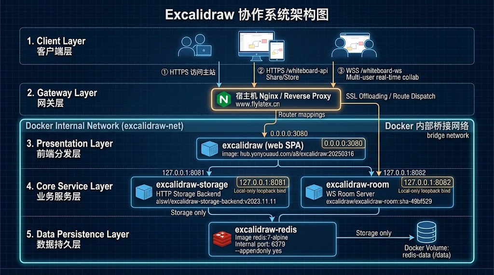
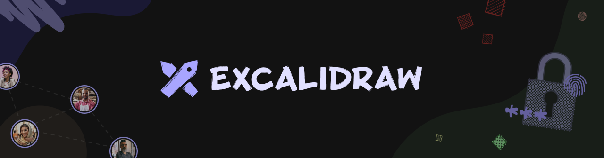
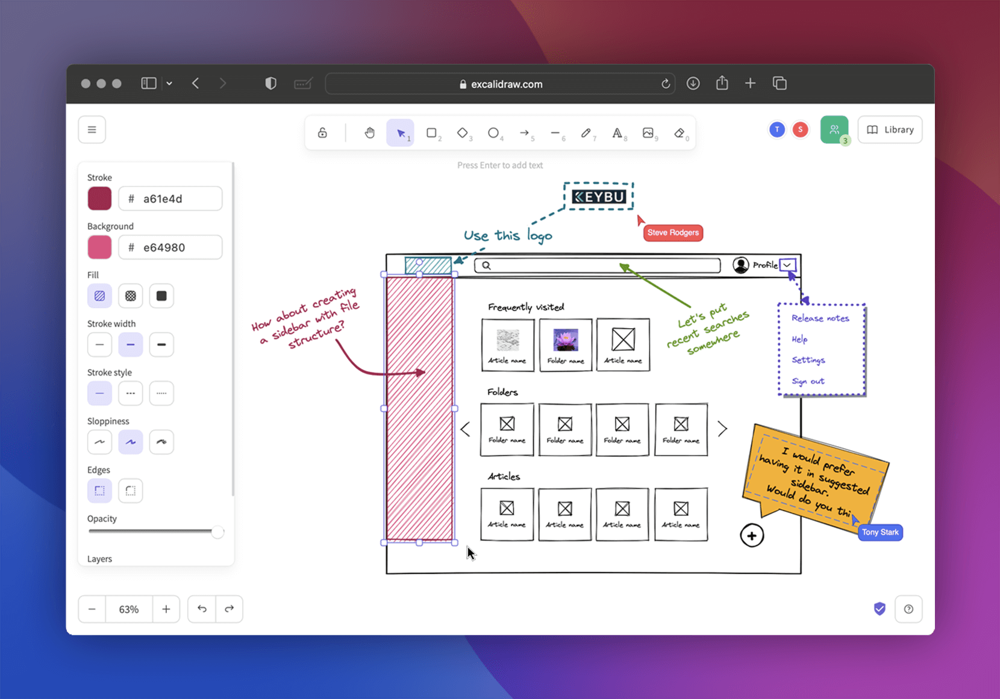

# FlyLaTeX Whiteboard


This is a fork of [Excalidraw](https://github.com/excalidraw/excalidraw) with some modifications to make it work with `FlyLaTeX`.

## Architecture

Self-hosted collaboration deployment (Nginx gateway + Docker internal network):



## Modifications

- Adds support for the `flylatex` theme.
- Change default context to `/app`.
- Integration with FlyLaTeX.
- Change some Label to `flylatex`.
- UI default language is `zh-CN`.

## Build

First Step:

clone the repository and install the dependencies.

> Important: **Node.js >= 20 is required** (22 LTS recommended; the Docker build uses `node:24`). Node 18 now fails at `yarn install`, see [Node Version Range](#node-version-range).

build the product with flow commands:

```bash
yarn
yarn build
```

Second Step:

build the docker image.

```shell
sudo docker build -t hub.yonyouaud.com/a8/excalidraw:20250316 .
```

> The `Dockerfile` is a multi-stage build: the `build` stage runs on `node:24` and does its own `yarn --frozen-lockfile` + `yarn build:app:docker`, then the result is copied into nginx under `/whiteboard`. So for the Docker path the host only needs Docker — no host `yarn`/`yarn build` (and the `build/` folder is excluded by `.dockerignore`). Running `yarn && yarn build` on the host is only needed when deploying the static build straight to nginx.

Third Step:

push docker image to hub.

```shell
sudo docker push hub.yonyouaud.com/a8/excalidraw:20250316
```

## Node Version Range

**Node.js >= 20.0.0 is required** since the upstream merge that brought in `mermaid@11` → `marked@16` (whose `engines.node` is `>= 20`). Node 18 can no longer install the tree:

```shell
$ node -v
v18.20.2
$ yarn
...
error marked@16.4.2: The engine "node" is incompatible with this module. Expected version ">= 20". Got "18.20.2"
error Found incompatible module.
```

| Where                           | Node version                            |
| ------------------------------- | --------------------------------------- |
| Local build / packaging machine | 20.x, 22.x or 24.x (22 LTS recommended) |
| Upstream CI                     | `20.x`                                  |
| `Dockerfile` (`build` stage)    | `node:24`                               |

Upgrading the build machine:

```shell
# Debian/Ubuntu (incl. WSL), as root
curl -fsSL https://deb.nodesource.com/setup_22.x | bash -
apt-get install -y nodejs
node -v                 # v22.x
npm i -g yarn@1.22.19   # keep yarn 1.x

cd excalidraw
rm -rf node_modules     # native binaries (rollup/esbuild) differ per install
yarn && yarn build
```

Escape hatch (not supported by upstream, but usually enough for a browser-only bundle — `mermaid`/`marked` end up as plain JS in the build):

```shell
yarn install --ignore-engines && yarn build
```

#### Tips

set the proxy:

```shell
# for example, set the proxy to 7890 port
yarn config set https-proxy http://127.0.0.1:7890
```

> [!IMPORTANT] This project is one part of FlyLaTeX.

> Main app in `excalidraw-app`, you need build it and copy `build` to nginx ROOT directory.

## Excalidraw

<a href="https://excalidraw.com/" target="_blank" rel="noopener">
  <picture>
    <source media="(prefers-color-scheme: dark)" alt="Excalidraw" srcset="https://excalidraw.nyc3.cdn.digitaloceanspaces.com/github/excalidraw_github_cover_2_dark.png" />
    
  </picture>
</a>

<h4 align="center">
  <a href="https://excalidraw.com">Excalidraw Editor</a> |
  <a href="https://plus.excalidraw.com/blog">Blog</a> |
  <a href="https://docs.excalidraw.com">Documentation</a> |
  <a href="https://plus.excalidraw.com">Excalidraw+</a>
</h4>

<div align="center">
  <h2>
    An open source virtual hand-drawn style whiteboard. </br>
    Collaborative and end-to-end encrypted. </br>
  <br />
  </h2>
</div>

<br />
<p align="center">
  <a href="https://github.com/excalidraw/excalidraw/blob/master/LICENSE">
    </a>
  <a href="https://www.npmjs.com/package/@excalidraw/excalidraw">
    </a>
  <a href="https://docs.excalidraw.com/docs/introduction/contributing">
    </a>
  <a href="https://discord.gg/UexuTaE">
    </a>
  <a href="https://deepwiki.com/excalidraw/excalidraw">
    </a>
  <a href="https://twitter.com/excalidraw">
    </a>
</p>

<div align="center">
  <figure>
    <a href="https://excalidraw.com" target="_blank" rel="noopener">
      
    </a>
    <figcaption>
      <p align="center">
        Create beautiful hand-drawn like diagrams, wireframes, or whatever you like.
      </p>
    </figcaption>
  </figure>
</div>

## Features

The Excalidraw editor (npm package) supports:

- 💯&nbsp;Free & open-source.
- 🎨&nbsp;Infinite, canvas-based whiteboard.
- ✍️&nbsp;Hand-drawn like style.
- 🌓&nbsp;Dark mode.
- 🏗️&nbsp;Customizable.
- 📷&nbsp;Image support.
- 😀&nbsp;Shape libraries support.
- 🌐&nbsp;Localization (i18n) support.
- 🖼️&nbsp;Export to PNG, SVG & clipboard.
- 💾&nbsp;Open format - export drawings as an `.excalidraw` json file.
- ⚒️&nbsp;Wide range of tools - rectangle, circle, diamond, arrow, line, free-draw, eraser...
- ➡️&nbsp;Arrow-binding & labeled arrows.
- 🔙&nbsp;Undo / Redo.
- 🔍&nbsp;Zoom and panning support.

## Excalidraw.com

The app hosted at [excalidraw.com](https://excalidraw.com) is a minimal showcase of what you can build with Excalidraw. Its [source code](https://github.com/excalidraw/excalidraw/tree/master/excalidraw-app) is part of this repository as well, and the app features:

- 📡&nbsp;PWA support (works offline).
- 🤼&nbsp;Real-time collaboration.
- 🔒&nbsp;End-to-end encryption.
- 💾&nbsp;Local-first support (autosaves to the browser).
- 🔗&nbsp;Shareable links (export to a readonly link you can share with others).

We'll be adding these features as drop-in plugins for the npm package in the future.

## Quick start

**Note:** following instructions are for installing the Excalidraw [npm package](https://www.npmjs.com/package/@excalidraw/excalidraw) when integrating Excalidraw into your own app. To run the repository locally for development, please refer to our [Development Guide](https://docs.excalidraw.com/docs/introduction/development).

Use `npm` or `yarn` to install the package.

```bash
npm install react react-dom @excalidraw/excalidraw
# or
yarn add react react-dom @excalidraw/excalidraw
```

Check out our [documentation](https://docs.excalidraw.com/docs/@excalidraw/excalidraw/installation) for more details!

## Contributing

- Missing something or found a bug? [Report here](https://github.com/excalidraw/excalidraw/issues).
- Want to contribute? Check out our [contribution guide](https://docs.excalidraw.com/docs/introduction/contributing) or let us know on [Discord](https://discord.gg/UexuTaE).
- Want to help with translations? See the [translation guide](https://docs.excalidraw.com/docs/introduction/contributing#translating).

## Integrations

- [VScode extension](https://marketplace.visualstudio.com/items?itemName=pomdtr.excalidraw-editor)
- [npm package](https://www.npmjs.com/package/@excalidraw/excalidraw)

## Who's integrating Excalidraw

[Google Cloud](https://googlecloudcheatsheet.withgoogle.com/architecture) • [Meta](https://meta.com/) • [CodeSandbox](https://codesandbox.io/) • [Obsidian Excalidraw](https://github.com/zsviczian/obsidian-excalidraw-plugin) • [Replit](https://replit.com/) • [Slite](https://slite.com/) • [Notion](https://notion.so/) • [HackerRank](https://www.hackerrank.com/) • and many others

## Sponsors & support

If you like the project, you can become a sponsor at [Open Collective](https://opencollective.com/excalidraw) or use [Excalidraw+](https://plus.excalidraw.com/).

## Thank you for supporting Excalidraw

[](https://opencollective.com/excalidraw/tiers/sponsors/0/website) [](https://opencollective.com/excalidraw/tiers/sponsors/1/website) [](https://opencollective.com/excalidraw/tiers/sponsors/2/website) [](https://opencollective.com/excalidraw/tiers/sponsors/3/website) [](https://opencollective.com/excalidraw/tiers/sponsors/4/website) [](https://opencollective.com/excalidraw/tiers/sponsors/5/website) [](https://opencollective.com/excalidraw/tiers/sponsors/6/website) [](https://opencollective.com/excalidraw/tiers/sponsors/7/website) [](https://opencollective.com/excalidraw/tiers/sponsors/8/website) [](https://opencollective.com/excalidraw/tiers/sponsors/9/website) [](https://opencollective.com/excalidraw/tiers/sponsors/10/website)

<a href="https://opencollective.com/excalidraw#category-CONTRIBUTE" target="_blank"></a>

Last but not least, we're thankful to these companies for offering their services for free:

[](https://vercel.com) [](https://sentry.io) [](https://crowdin.com)

## Runtime configuration (collaboration / storage)

The collaboration and scene-storage endpoints can be changed **without rebuilding** the image. At container start, `docker/99-excalidraw-runtime-config.sh` generates `/usr/share/nginx/html/whiteboard/runtime-config.js` from the following environment variables, and the app prefers these values over the build-time `.env.production` ones:

| Variable | Description | Default |
| --- | --- | --- |
| `EXCALIDRAW_COLLAB_URL` | Collaboration WebSocket origin, e.g. `wss://whiteboard.example.com` | `VITE_APP_WS_SERVER_URL` |
| `EXCALIDRAW_COLLAB_PATH` | Socket.IO path (optional), e.g. `/whiteboard-socket.io/` | `/socket.io/` |
| `EXCALIDRAW_BACKEND_URL` | Scene storage base URL, e.g. `https://whiteboard.example.com/whiteboard-api` | `VITE_APP_BACKEND_V2_GET_URL` |
| `EXCALIDRAW_BACKEND_API_PREFIX` | API path appended to the base URL (optional) | `/api/v2` |
| `EXCALIDRAW_BACKEND_GET_URL` | Full read endpoint (optional, overrides base + prefix) | `<base><prefix>/` |
| `EXCALIDRAW_BACKEND_POST_URL` | Full write endpoint (optional, overrides base + prefix) | `<base><prefix>/post/` |

Example (avoid clashing with an existing `/api/v1` or `/api/v2` on the same domain):

```yaml
services:
  excalidraw:
    image: hub.yonyouaud.com/a8/excalidraw:20250316
    environment:
      EXCALIDRAW_COLLAB_URL: wss://www.flylatex.cn
      # keep collaboration off the /socket.io/ already used by another service
      EXCALIDRAW_COLLAB_PATH: /whiteboard-socket.io/
      # unique external path, so it does not clash with the domain's /api/v2:
      # GET  -> https://www.flylatex.cn/whiteboard-api/api/v2/
      # POST -> https://www.flylatex.cn/whiteboard-api/api/v2/post/
      EXCALIDRAW_BACKEND_URL: https://www.flylatex.cn/whiteboard-api/api/v2
```

nginx then routes only the dedicated prefix to the storage service, e.g.:

```nginx
location /whiteboard-api/ {
    proxy_pass http://127.0.0.1:8081/;
}

location /whiteboard-socket.io/ {
    rewrite ^/whiteboard-socket.io/(.*)$ /socket.io/$1 break;
    proxy_pass http://127.0.0.1:8082;
    proxy_http_version 1.1;
    proxy_set_header Upgrade $http_upgrade;
    proxy_set_header Connection "Upgrade";
    proxy_set_header Host $host;
}
```

If the storage backend does not implement the official `/api/v2/` + `/api/v2/post/` routes (for example `alswl/excalidraw-storage-backend` exposes `/scenes/` and `/scenes`), set the full URLs instead:

```yaml
EXCALIDRAW_BACKEND_GET_URL: https://www.flylatex.cn/whiteboard-api/api/v2/scenes/
EXCALIDRAW_BACKEND_POST_URL: https://www.flylatex.cn/whiteboard-api/api/v2/scenes
```

Notes:

- `EXCALIDRAW_COLLAB_URL` must be an origin (`scheme://host[:port]`). A path would be interpreted by `socket.io-client` as a namespace, which `excalidraw-room` does not serve. The entrypoint strips the path and logs a warning if one is present.
- Use `EXCALIDRAW_COLLAB_PATH` when the domain's default `/socket.io/` is already taken; nginx must rewrite that path back to `/socket.io/` for the room server (see above).
- `EXCALIDRAW_BACKEND_URL` is the full API base; include your unique path directly (e.g. `/whiteboard-api/api/v2`). If you prefer origin + prefix instead, set `EXCALIDRAW_BACKEND_API_PREFIX`; don't repeat the same path in both variables.
- If no variables are set, the build-time values from `.env.production` are used.

## AI (text-to-diagram) configuration

The AI features are provider-agnostic. `VITE_APP_AI_PROVIDER` (build time) or `EXCALIDRAW_AI_PROVIDER` (runtime) selects the protocol:

| Provider | Behaviour |
| --- | --- |
| `deepseek` (default in `.env.*`) | Calls an **OpenAI-compatible** `POST <base>/chat/completions` directly from the browser, streaming SSE. Users paste their own API key in **菜单 → AI 设置** (stored in `localStorage`, never sent anywhere but the AI provider). |
| `excalidraw` | Talks to an excalidraw AI service (`/v1/ai/text-to-diagram/chat-streaming`, `/v1/ai/diagram-to-code/generate-streaming`), which additionally enables the wireframe → code plugin. |

| Variable | Description | Default |
| --- | --- | --- |
| `EXCALIDRAW_AI_PROVIDER` | `deepseek` or `excalidraw` | `VITE_APP_AI_PROVIDER` |
| `EXCALIDRAW_AI_BACKEND` | AI base URL, e.g. `https://api.deepseek.com` | `VITE_APP_AI_BACKEND` |
| `EXCALIDRAW_AI_MODEL` | Model name, e.g. `deepseek-chat` | `VITE_APP_AI_MODEL` |
| `EXCALIDRAW_AI_API_KEY` | Optional shared key injected at container start (used as a fallback when the visitor has not entered their own key) | — (users set their own key) |

```yaml
EXCALIDRAW_AI_PROVIDER: deepseek
EXCALIDRAW_AI_BACKEND: https://api.deepseek.com
EXCALIDRAW_AI_MODEL: deepseek-chat
```

Notes:

- DeepSeek has no vision model, so with `deepseek` the _wireframe → code_ entry is hidden automatically (`DiagramToCodePlugin` is only registered for the `excalidraw` provider).
- Any OpenAI-compatible gateway works (vLLM, OpenRouter, an internal proxy …) — point `EXCALIDRAW_AI_BACKEND` at it. A key injected via `EXCALIDRAW_AI_API_KEY` is visible to every visitor of the deployment, so prefer letting users enter their own key.

## AI canvas agent (client-side)

In addition to the text-to-diagram dialog, the right-hand **AI 助手** panel runs a tool-calling agent that reads and edits the live canvas. Everything happens in the browser — there is no server-side agent:

```
user message ─▶ runAgent() ─▶ POST <AI_BACKEND>/chat/completions (streaming SSE, tools)
                    │  ▲
        tool_calls  ▼  │  tool results
                ToolRegistry ──▶ read_canvas / write_canvas / read_selection / replace_selection
                    │
                    ▼
            localStorage snapshot ──▶ updateScene() (one undoable step)
```

### Tools

| Tool | Purpose |
| --- | --- |
| `read_canvas` | Reads the canvas as numbered lines (`L12: {...}`, one element per line), paged (`offset`/`limit`, max 120 lines per call). |
| `write_canvas` | Line-based editing: `replace` / `delete` / `insert` / `append` / `replace_all`. Lines are element JSON; existing elements are merged by `id` (partial patches allowed), new elements only need a `type`. All-or-nothing: one invalid line aborts the write. |
| `read_selection` | Returns only the elements the user has selected and records a `selectionId` (element ids + z-order). |
| `replace_selection` | Replaces exactly the recorded range, so "change _this_" never touches the rest of the canvas. Omitted elements are deleted, new lines are inserted in place, z-order is preserved. |

Writes go through `buildElementsFromLines()` → `restoreElements()` (dimension and binding repair, text re-measuring/centering) and are applied with a single `updateScene({ captureUpdate: IMMEDIATELY })`, so the canvas never flickers and `Ctrl+Z` reverts the whole agent edit at once.

### Conversation state

| `localStorage` key | Contents |
| --- | --- |
| `excalidraw-agent-scene` | Line-numbered canvas snapshot (`rev`, `lines`, `ids`) the model reads, updated from the canvas before every read/write. |
| `excalidraw-agent-chat` | Transcript (messages for the model + rendered items). Only the **last 10 user turns** (and ~60k characters) are sent to the model; older turns stay on screen but are dropped from the request. |

Loop guard rails (see `excalidraw-app/agent/loop.ts`): max 16 iterations per turn, 12k characters per tool result, the same failing call is not retried more than twice, and a turn stops after 6 failed tool calls.

The agent uses the same provider settings as text-to-diagram (`EXCALIDRAW_AI_*`, key from **AI 设置**), so `deepseek-chat` works out of the box; any OpenAI-compatible endpoint with tool-calling support (a local vLLM, an internal gateway, …) can be used by pointing `EXCALIDRAW_AI_BACKEND` / `EXCALIDRAW_AI_MODEL` at it.

Agent modules live in `excalidraw-app/agent/` (`provider.ts`, `loop.ts`, `registry.ts`, `tools.ts`, `sceneView.ts`, `sceneStore.ts`, `chatStore.ts`, `useAgent.ts`); the panel is `excalidraw-app/components/AgentPanel.tsx`.
