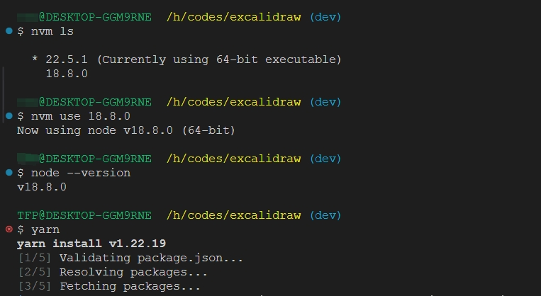

# FlyLaTeX Whiteboard


This is a fork of [Excalidraw](https://github.com/excalidraw/excalidraw) with some modifications to make it work with `FlyLaTeX`.

## Modifications

- Adds support for the `flylatex` theme.
- Change default context to `/app`.
- Integration with FlyLaTeX.
- Change some Label to `flylatex`.
- UI default language is `zh-CN`.

## Build

First Step:

clone the repository and install the dependencies.

> Important: The node version must in [18.17.1] range.

build the product with flow commands:
```bash
yarn
yarn build
```

Second Step:

copy the build folder to the flylatex server and build the docker image.

```shell
sudo docker build -t hub.yonyouaud.com/a8/excalidraw:20250316 .
```

Third Step:

push docker image to hub.

```shell
sudo docker push hub.yonyouaud.com/a8/excalidraw:20250316
```

## Node Version Range

Node version must in [18.17-20.x] range.



Build failed when node version out of range.

```shell
excalidraw-monorepo@: The engine "node" is incompatible with this module. Expected version "18.0.0 - 20.x.x". Got "22.5.1"

next@14.1.4: The engine "node" is incompatible with this module. Expected version ">=18.17.0". Got "18.8.0"
```

Recommend to use node version **18.17.1**.

#### Tips

set the proxy:
```shell
# for example, set the proxy to 7890 port
yarn config set https-proxy http://127.0.0.1:7890
```

>[!IMPORTANT]
> This project is one part of FlyLaTeX.

> Main app in `excalidraw-app`, you need build it and copy `build` to nginx ROOT directory.

## Excalidraw

<a href="https://excalidraw.com/" target="_blank" rel="noopener">
  <picture>
    <source media="(prefers-color-scheme: dark)" alt="Excalidraw" srcset="https://excalidraw.nyc3.cdn.digitaloceanspaces.com/github/excalidraw_github_cover_2_dark.png" />
    
  </picture>
</a>

<h4 align="center">
  <a href="https://excalidraw.com">Excalidraw Editor</a> |
  <a href="https://blog.excalidraw.com">Blog</a> |
  <a href="https://docs.excalidraw.com">Documentation</a> |
  <a href="https://plus.excalidraw.com">Excalidraw+</a>
</h4>

<div align="center">
  <h2>
    An open source virtual hand-drawn style whiteboard. </br>
    Collaborative and end-to-end encrypted. </br>
  <br />
  </h2>
</div>

<br />
<p align="center">
  <a href="https://github.com/excalidraw/excalidraw/blob/master/LICENSE">
    
  </a>
  <a href="https://www.npmjs.com/package/@excalidraw/excalidraw">
    
  </a>
  <a href="https://docs.excalidraw.com/docs/introduction/contributing">
    
  </a>
  <a href="https://discord.gg/UexuTaE">
    
  </a>
  <a href="https://twitter.com/excalidraw">
    
  </a>
</p>

<div align="center">
  <figure>
    <a href="https://excalidraw.com" target="_blank" rel="noopener">
      
    </a>
    <figcaption>
      <p align="center">
        Create beautiful hand-drawn like diagrams, wireframes, or whatever you like.
      </p>
    </figcaption>
  </figure>
</div>

## Features

The Excalidraw editor (npm package) supports:

- 💯&nbsp;Free & open-source.
- 🎨&nbsp;Infinite, canvas-based whiteboard.
- ✍️&nbsp;Hand-drawn like style.
- 🌓&nbsp;Dark mode.
- 🏗️&nbsp;Customizable.
- 📷&nbsp;Image support.
- 😀&nbsp;Shape libraries support.
- 👅&nbsp;Localization (i18n) support.
- 🖼️&nbsp;Export to PNG, SVG & clipboard.
- 💾&nbsp;Open format - export drawings as an `.excalidraw` json file.
- ⚒️&nbsp;Wide range of tools - rectangle, circle, diamond, arrow, line, free-draw, eraser...
- ➡️&nbsp;Arrow-binding & labeled arrows.
- 🔙&nbsp;Undo / Redo.
- 🔍&nbsp;Zoom and panning support.

## Excalidraw.com

The app hosted at [excalidraw.com](https://excalidraw.com) is a minimal showcase of what you can build with Excalidraw. Its [source code](https://github.com/excalidraw/excalidraw/tree/master/excalidraw-app) is part of this repository as well, and the app features:

- 📡&nbsp;PWA support (works offline).
- 🤼&nbsp;Real-time collaboration.
- 🔒&nbsp;End-to-end encryption.
- 💾&nbsp;Local-first support (autosaves to the browser).
- 🔗&nbsp;Shareable links (export to a readonly link you can share with others).

We'll be adding these features as drop-in plugins for the npm package in the future.

## Quick start

**Note:** following instructions are for installing the Excalidraw [npm package](https://www.npmjs.com/package/@excalidraw/excalidraw) when integrating Excalidraw into your own app. To run the repository locally for development, please refer to our [Development Guide](https://docs.excalidraw.com/docs/introduction/development).

```
npm install react react-dom @excalidraw/excalidraw
```

or via yarn

```
yarn add react react-dom @excalidraw/excalidraw
```

Check out our [documentation](https://docs.excalidraw.com/docs/@excalidraw/excalidraw/installation) for more details!

## Contributing

- Missing something or found a bug? [Report here](https://github.com/excalidraw/excalidraw/issues).
- Want to contribute? Check out our [contribution guide](https://docs.excalidraw.com/docs/introduction/contributing) or let us know on [Discord](https://discord.gg/UexuTaE).
- Want to help with translations? See the [translation guide](https://docs.excalidraw.com/docs/introduction/contributing#translating).

## Integrations

- [VScode extension](https://marketplace.visualstudio.com/items?itemName=pomdtr.excalidraw-editor)
- [npm package](https://www.npmjs.com/package/@excalidraw/excalidraw)

## Who's integrating Excalidraw

[Google Cloud](https://googlecloudcheatsheet.withgoogle.com/architecture) • [Meta](https://meta.com/) • [CodeSandbox](https://codesandbox.io/) • [Obsidian Excalidraw](https://github.com/zsviczian/obsidian-excalidraw-plugin) • [Replit](https://replit.com/) • [Slite](https://slite.com/) • [Notion](https://notion.so/) • [HackerRank](https://www.hackerrank.com/) • and many others

## Sponsors & support

If you like the project, you can become a sponsor at [Open Collective](https://opencollective.com/excalidraw) or use [Excalidraw+](https://plus.excalidraw.com/).

## Thank you for supporting Excalidraw

[](https://opencollective.com/excalidraw/tiers/sponsors/0/website) [](https://opencollective.com/excalidraw/tiers/sponsors/1/website) [](https://opencollective.com/excalidraw/tiers/sponsors/2/website) [](https://opencollective.com/excalidraw/tiers/sponsors/3/website) [](https://opencollective.com/excalidraw/tiers/sponsors/4/website) [](https://opencollective.com/excalidraw/tiers/sponsors/5/website) [](https://opencollective.com/excalidraw/tiers/sponsors/6/website) [](https://opencollective.com/excalidraw/tiers/sponsors/7/website) [](https://opencollective.com/excalidraw/tiers/sponsors/8/website) [](https://opencollective.com/excalidraw/tiers/sponsors/9/website) [](https://opencollective.com/excalidraw/tiers/sponsors/10/website)

<a href="https://opencollective.com/excalidraw#category-CONTRIBUTE" target="_blank"></a>

Last but not least, we're thankful to these companies for offering their services for free:

[](https://vercel.com) [](https://sentry.io) [](https://crowdin.com)

## Runtime configuration (collaboration / storage)

The collaboration and scene-storage endpoints can be changed **without rebuilding** the
image. At container start, `docker/99-excalidraw-runtime-config.sh` generates
`/usr/share/nginx/html/whiteboard/runtime-config.js` from the following environment
variables, and the app prefers these values over the build-time `.env.production` ones:

| Variable | Description | Default |
| --- | --- | --- |
| `EXCALIDRAW_COLLAB_URL` | Collaboration WebSocket origin, e.g. `wss://whiteboard.example.com` | `VITE_APP_WS_SERVER_URL` |
| `EXCALIDRAW_COLLAB_PATH` | Socket.IO path (optional), e.g. `/whiteboard-socket.io/` | `/socket.io/` |
| `EXCALIDRAW_BACKEND_URL` | Scene storage base URL, e.g. `https://whiteboard.example.com/whiteboard-api` | `VITE_APP_BACKEND_V2_GET_URL` |
| `EXCALIDRAW_BACKEND_API_PREFIX` | API path appended to the base URL (optional) | `/api/v2` |
| `EXCALIDRAW_BACKEND_GET_URL` | Full read endpoint (optional, overrides base + prefix) | `<base><prefix>/` |
| `EXCALIDRAW_BACKEND_POST_URL` | Full write endpoint (optional, overrides base + prefix) | `<base><prefix>/post/` |

Example (avoid clashing with an existing `/api/v1` or `/api/v2` on the same domain):

```yaml
services:
  excalidraw:
    image: hub.yonyouaud.com/a8/excalidraw:20250316
    environment:
      EXCALIDRAW_COLLAB_URL: wss://www.flylatex.cn
      # keep collaboration off the /socket.io/ already used by another service
      EXCALIDRAW_COLLAB_PATH: /whiteboard-socket.io/
      # unique external path, so it does not clash with the domain's /api/v2:
      # GET  -> https://www.flylatex.cn/whiteboard-api/api/v2/
      # POST -> https://www.flylatex.cn/whiteboard-api/api/v2/post/
      EXCALIDRAW_BACKEND_URL: https://www.flylatex.cn/whiteboard-api/api/v2
```

nginx then routes only the dedicated prefix to the storage service, e.g.:

```nginx
location /whiteboard-api/ {
    proxy_pass http://127.0.0.1:8081/;
}

location /whiteboard-socket.io/ {
    rewrite ^/whiteboard-socket.io/(.*)$ /socket.io/$1 break;
    proxy_pass http://127.0.0.1:8082;
    proxy_http_version 1.1;
    proxy_set_header Upgrade $http_upgrade;
    proxy_set_header Connection "Upgrade";
    proxy_set_header Host $host;
}
```

If the storage backend does not implement the official `/api/v2/` + `/api/v2/post/`
routes (for example `alswl/excalidraw-storage-backend` exposes `/scenes/` and `/scenes`),
set the full URLs instead:

```yaml
      EXCALIDRAW_BACKEND_GET_URL: https://www.flylatex.cn/whiteboard-api/api/v2/scenes/
      EXCALIDRAW_BACKEND_POST_URL: https://www.flylatex.cn/whiteboard-api/api/v2/scenes
```

Notes:

- `EXCALIDRAW_COLLAB_URL` must be an origin (`scheme://host[:port]`). A path would be
  interpreted by `socket.io-client` as a namespace, which `excalidraw-room` does not serve.
  The entrypoint strips the path and logs a warning if one is present.
- Use `EXCALIDRAW_COLLAB_PATH` when the domain's default `/socket.io/` is already taken;
  nginx must rewrite that path back to `/socket.io/` for the room server (see above).
- `EXCALIDRAW_BACKEND_URL` is the full API base; include your unique path directly
  (e.g. `/whiteboard-api/api/v2`). If you prefer origin + prefix instead, set
  `EXCALIDRAW_BACKEND_API_PREFIX`; don't repeat the same path in both variables.
- If no variables are set, the build-time values from `.env.production` are used.
